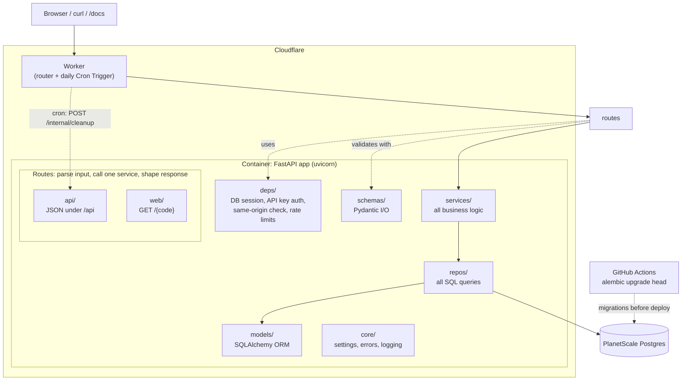
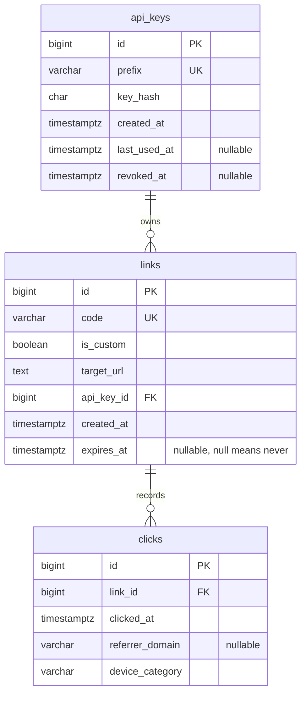

# url-shortener

[](https://github.com/edward-sf/url-shortener/actions/workflows/ci.yml)

URL shortener built with FastAPI and hosted in Cloudflare Containers with Planetscale Postgres. Short links, click stats, link expiry, and a minimal Jinja2 + HTMX front end.

> **Status:** in development. The project skeleton, tooling and CI are in place;
> features are being built in the order listed in the
> [design spec](docs/specs/url-shortener-design-spec.md#12-suggested-build-order).

## v1.0.0 Dev Roadmap

- [x] :white_check_mark: P0: Project skeleton, settings, Docker Compose, CI (lint/type/test on an empty app).
- [x] :white_check_mark: P1: Models, first Alembic migration, migration round-trip test, DB session and lifespan, `/health` running `SELECT 1`, transactional test fixture, `make migrate`.
- [ ] P2: Error envelope, then API keys: generation, hashing, `require_api_key` (header and cookie), `POST /api/keys`. Coverage gate in CI.
- [ ] P3: Links! Code generation, aliases, expiry, URL validation, create/list/get/delete, `make seed`.
- [ ] P4: Redirect, click recording, 404/410
- [ ] P5: Stats queries, `/stats` endpoint.
- [ ] P6: Rate limiting.
- [ ] P7: Web frontend (templates, HTMX, cookie flow, CSRF check, SVG chart).
- [ ] P8: Cleanup endpoint + Cron Trigger.
- [ ] P9: Production Dockerfile, CI image build, Cloudflare Containers + PlanetScale deployment, CD pipeline, smoke test
- [ ] P10: Go-live README edit, live URL, `curl` demo, publish to portfolio

## Architecture



### Layer rules
- **Routes** parse input, call one service, shape the response. No business logic, no queries.
- **Services** hold all logic and are unit-testable without HTTP.
- **Repos** are the only code that builds queries.
- **Schemas are not models.** Pydantic schemas (`LinkCreate`, `LinkOut`, `StatsOut`, ...) are never ORM models.

**Scheduled cleanup:** a Cloudflare Cron Trigger (daily) on the Worker calls `POST /internal/cleanup` with a shared secret header (`X-Cleanup-Secret`). The endpoint deletes links whose `exipres_at` is more than **30 days** in the past (clicks cascade). Request-time expiry checks keep behavior correct even if cleanup hasn't run.

**Redirect status:** **307 Temporary Redirect.** A 301 would be cached by browsers, so repeat clicks wouldn't be counted and expired links would keep working.

## Data model



- **Cascading deletes live in Postgres.** Deleting a key removes its links, and deleting a link removes its clicks, even for writes that bypass the ORM.
- **Indexes match the queries the app runs.**
    - `links(code)` is unique, which rejects duplicate codes and makes redirect lookups fast.
    - `links(api_key_id, created_at DESC, id DESC)` serves "My links". Postgres reads rows already in newest-first order and stops at the page limit, without sorting. `id` breaks ties between identical timestamps, which keeps cursor pagination stable.
    - `links(expires_at) WHERE expires_at IS NOT NULL` serves the cleanup job. It's a partial index, so links that never expire take up no space in it.
    - `clicks(link_id, clicked_at)` serves per-link stats, which filter by link and then by a date range.
- **API Keys are stored only as SHA-256 hashes.** A database leak doesn't expose usable keys, and the raw key is shown only once, at creation. A short public prefix finds the row, then `hmac.compare_digest` compares the hashes in constant time. SHA-256 is safe here because generated keys have about 190 bits of entropy, which makes guessing infeasible. Slow hashes like argon2 protect low-entropy, human-chosen passwords, and would only add latency to every authenticated request.
- **IP Addresses are deliberately not stored.** Each click records only the time, the referrer's domain and a coarse device category. Keeping personal data out of the table avoids the retention and consent obligations that come with it.
- **Click counts are derived from the event table, not stored in a counter.** `COUNT(*)` over the `(link_id, clicked_at)` index is fast at this scale, and there's no counter to keep in sync with the events. If traffic outgrows that, pre-aggregated rollups are the planned path.

## Design decisions

- **API keys.** | Each link belongs to one key. No user accounts in v1.
- **Browser identity** | Key *issued automatically, on demand* (when the first link is created), stored in an HttpOnly cookie.
- **Event table** | Clicks are tracked in Postgres (`clicks`), inserted via FastAPI `BackgroundTasks`. Stores referrer *domain* and a coarse device category. No IP addresses stored.
- **Short codes** | Random 7-character base62, collision handled by unique constrain + retry. Optional custom aliases.
- **Code expiry** | 30-day default; creator may choose a duration, a date, or "never". Max 365 days. Enforced at request time (410); cleanup job deletes old expired links.
- **Frontend** | Jinja2 + HTMX, served by the same FastAPI app. Architecture separates stack concerns to make a later React frontend standup easier. The following rules make this later work simpler:
    1. HTML routes and API routes call the **same service layer**. No feature exists only in HTML.
    2. HTML routes live in their own router package (`web/`), separate from `api/`.
    3. A single auth dependency accepts the key from **either** `Authorization: Bearer` **or** the `sk` cookie.
- **Database** | PostgreSQL + SQLAlchemy 2.0 (async, asyncpg) + Alembic. Pydantic schemas and ORM models kept separate.
- **Hosting** | Cloudflare Containers (Workers Paid, ~$5/mo) for the app.
- **Database host** | PlanetScale Postgres, single node (~$5/mo), created and billed through Cloudflare. Connected directly from the container (no Hyperdrive).

## Known limits

TBD

## Running locally

### Requirements

- [uv](https://docs.astral.sh/uv/) (installs Python 3.12 for you)
- [Docker](https://docs.docker.com/get-docker/) or [OrbStack](https://orbstack.dev/)
- GNU Make

### Getting started
```
cp .env.example .env
uv sync
uv run pre-commit install
make dev
make migrate
make test-db
```

Then open http://localhost:8000/health or http://localhost:8000/docs.

### Development

| Command | What it does |
| ------- | ------------ |
| `make dev` | Start Postgres + the app with live reload |
| `make migrate` | Apply database migrations to the dev database |
| `make test-db` | Create the test database (once per Docker volume) |
| `make down` | Stop containers (keeps the database volume) |
| `make check` | Lint, type-check and test (same as CI) |
| `make format` | Auto-fix lint issues and format code |

Run `make` to list every command.

### Project layout
```
src/url_shortener/
    api/        JSON routers under /api
    web/        HTML routes (Jinja2 + HTMX)
    deps/       FastAPI dependencies (DB session, auth, rate limits)
    services/   business logic
    repos/      database queries
    models/     SQLAlchemy ORM models
    schemas/    Pydantic request/response models
    core/       settings, errors, logging
```

See the [design spec](docs/specs/url-shortener-design-spec.md) for the full architecture and the reasons behind it.

## Feature Roadmap

1. **User Accounts & Auth:** To expand beyond browser-bound API keys and allow persistent, cross-device management of one's URLs, we need to build features for secure, authenticated user accounts. Hand-rolling auth will be the primary set of skills demonstrated in this feature.

2. **React frontend:** We've built our current frontend as a quick-and-easy option to UI. We've also built it in a way that prepares for replacement with a more industry-standard frontend framework. It doesn't need to be React necessarily, but that would be an obvious choice.

## License

[MIT](LICENSE)

## Contributors

| Contributor | GitHub | Portfolio |
| ----------- | ------ | --------- |
| Edward Simpson-Fitzgibbon | [edward-sf](https://github.com/edward-sf) | [edward-sf.dev](https://edward-sf.dev)
